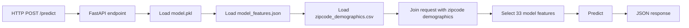
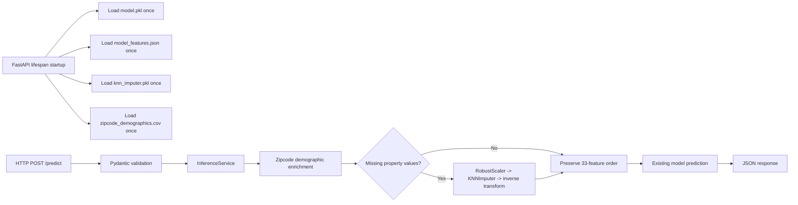

# Technical Report

## 1. Executive Summary
Sound Realty's original Seattle home-price inference service served a pre-trained model through FastAPI, but it could not handle missing numeric inputs and performed repeated artifact loading on every request. The implemented solution preserves the existing model and API contract, adds offline-fitted KNN-based missing-data imputation, loads inference resources once at startup, strengthens validation and error handling, and documents measured quality and latency trade-offs using reproducible repository artifacts.

## 2. Original Architecture and Identified Problems
The original service exposed `/predict` as a thin API layer around request-time preprocessing and model invocation. Based on the repository assessment and the legacy prediction helper preserved in the tests, the request path repeatedly loaded the model, feature metadata, and zipcode demographics for each prediction.

### Original inference path

### Problems identified
- **Repeated model loading**: `model.pkl` was deserialized on every request, adding avoidable I/O and CPU overhead.
- **Repeated feature metadata loading**: `model_features.json` was re-read per request instead of treated as immutable application state.
- **Repeated demographic CSV loading**: `zipcode_demographics.csv` was read repeatedly, even though zipcode features are static reference data.
- **No missing-value support**: the API accepted only complete numeric property inputs, which did not match the stated business need for incomplete real-estate records.
- **Limited input validation**: the public contract needed explicit zipcode validation, numeric domain checks, and clearer separation between client errors and internal failures.
- **API and inference coupling**: preprocessing, demographic enrichment, artifact loading, and prediction behavior were not encapsulated behind a dedicated inference abstraction.
- **Limited automated testing**: the original project needed stronger coverage for initialization, prediction compatibility, invalid input, and missing-data behavior.

## 3. Implemented Solution
The current implementation separates startup initialization, request validation, preprocessing, imputation, and prediction while preserving the external `/predict` response format and the model's internal 33-feature contract.

### Updated inference path

### Main implementation elements
- **FastAPI lifespan initialization**: `src/main.py` creates the application with a lifespan handler that loads inference resources once per worker and stores the ready state in `app.state`.
- **InferenceService abstraction**: `src/services/inference.py` encapsulates artifact loading, zipcode enrichment, feature preparation, contract validation, and prediction.
- **Preloaded artifacts and zipcode lookup**: the service loads `model.pkl`, `model_features.json`, `knn_imputer.pkl`, and `zipcode_demographics.csv` once, then keeps precomputed zipcode lookup structures in memory.
- **Preserved 33-feature contract**: the service validates that the model input schema still contains exactly 33 ordered features and that the property-feature prefix matches the public request schema.
- **KNN imputation**: `src/preprocessing/imputation.py` uses `KNNImputer(n_neighbors=5, weights="distance")`, consistent with the notebook research baseline.
- **Feature scaling with RobustScaler**: KNN distances are computed in a robustly scaled feature space to reduce domination by large-magnitude variables.
- **Offline fitting on training reference data**: `create_imputer.py` reconstructs the original `train_test_split(random_state=42)` and fits the imputer artifact on training features only, excluding the target.
- **Improved validation and error handling**: `src/api/endpoints.py` validates zipcode format and numeric domains, returns `422` for invalid client input, and hides internal stack details behind a generic `500`.
- **Preserved complete-input behavior**: complete requests bypass imputation so the service does not alter the no-missing inference path unnecessarily.

## 4. Engineering Decisions and Trade-offs

| Decision | Benefit | Limitation |
| --- | --- | --- |
| Preserve the existing prediction model | Meets the project constraint and avoids retraining risk | The model was not retrained to learn from imputed inputs |
| Use KNN instead of mean/median for missing-data serving | Measured Phase 4 results show better prediction quality under missingness | Runtime inference is slower for requests with missing values |
| Use `RobustScaler` before KNN | Distance calculations are less dominated by very large feature magnitudes | Adds extra preprocessing work on missing-value requests |
| Fit the imputer offline | Avoids request-time fitting and target leakage; keeps startup validation deterministic | Adds one more serialized artifact to manage |
| Initialize resources once per worker | Removes repeated file I/O and deserialization from the hot path | Each worker keeps its own model and imputer copy in memory |
| Bypass imputation for complete requests | Preserves compatibility with the prior complete-input prediction path | Creates two serving paths that must both remain tested |

### Why these choices were made
- **Existing model preserved**: `CANDIDATE_PROJECT.md` explicitly treats retraining as out of scope, so the work focused on serving and preprocessing improvements around `model.pkl`.
- **KNN selected over mean/median**: Phase 4 evaluation shows that KNN is consistently closer to the complete-input baseline than simple imputers under missingness.
- **RobustScaler selected**: the internal 33-feature space mixes property sizes, demographic counts, and monetary variables, making unscaled distance-based imputation fragile.
- **Offline imputer fitting**: this keeps the inference path deterministic and prevents leakage from request-time fitting or accidental use of target labels.
- **Per-worker startup initialization**: FastAPI lifespan is a natural boundary for fail-fast resource validation and in-memory reuse.
- **Complete-input bypass**: this minimizes serving drift for the no-missing path and preserves Phase 2/3 compatibility expectations.

## 5. Evaluation and Measured Results
All metrics below come from repository artifacts or from tests executed during the final review. No new evaluation was run for this report.

### A. Prediction quality
Evaluation context from `artifacts/phase4/evaluation_results.json`:
- reconstructed split using `train_test_split(random_state=42)`
- `16209` training rows
- `5404` evaluation rows
- `33` model features, of which `7` are API-exposed property inputs

#### KNN quality across missingness scenarios

| Scenario | MAE | RMSE | R² | Success Rate |
| --- | ---: | ---: | ---: | ---: |
| Complete input baseline | 102085.9804 | 201684.7713 | 0.7281 | 100.0% |
| 5% random missingness | 102403.2805 | 203048.5658 | 0.7244 | 100.0% |
| 15% random missingness | 103431.6277 | 205987.6953 | 0.7163 | 100.0% |
| 30% random missingness | 106250.7167 | 209477.6197 | 0.7067 | 100.0% |
| Structured missing groups | 103120.4199 | 202154.2931 | 0.7268 | 100.0% |

#### Strategy comparison at 15% random missingness

| Strategy | MAE | RMSE | R² |
| --- | ---: | ---: | ---: |
| Mean imputation | 110036.1773 | 216485.0168 | 0.6867 |
| Median imputation | 110118.1071 | 220129.0013 | 0.6761 |
| KNN with RobustScaler | 103431.6277 | 205987.6953 | 0.7163 |

#### Interpretation
- KNN performs best among the evaluated imputers for the reported missing-data scenarios.
- `knn_scaled_distance` and `current_production` are numerically identical in the artifact, supporting that the deployed serving configuration matches the evaluated KNN design.
- All evaluation scenarios report `100.0%` successful processing, but they should still be treated as reconstructed validation results rather than unbiased generalization estimates.

### B. Performance
The repository contains one current benchmark artifact and one stored historical baseline inside `artifacts/phase4/benchmark_results.json`.

#### Benchmark methodology notes
- The stored **historical baseline** is labeled `phase3_baseline` in the artifact.
- A standalone **Phase 2 performance artifact** is not present in the current repository, so this report does not invent Phase 2 latency numbers.
- The current **Phase 4 service benchmark** reports in-process latency over `200` iterations.
- The current **HTTP benchmark** is a separate end-to-end load test with `120` requests at concurrency `12`.
- The **component profile** times are not additive; they were measured independently and can sum to more than end-to-end latency.

#### Historical and current latency summary

| Milestone / Source | Complete Mean (ms) | Complete Median (ms) | Complete P95 (ms) | Missing Mean (ms) | Missing Median (ms) | Missing P95 (ms) |
| --- | ---: | ---: | ---: | ---: | ---: | ---: |
| Phase 2 | N/A | N/A | N/A | N/A | N/A | N/A |
| Phase 3 baseline stored in Phase 4 artifact | 2.785 | 2.743 | 3.824 | 92.477 | 94.618 | 114.606 |
| Phase 4 service benchmark | 1.709 | 1.227 | 2.798 | 99.984 | 99.147 | 120.260 |

#### Performance interpretation
- Complete-input latency improved from the stored historical baseline (`2.785 ms`) to the measured Phase 4 mean (`1.709 ms`), a reported `38.64%` improvement.
- Missing-input latency regressed from the stored historical baseline (`92.477 ms`) to the measured Phase 4 mean (`99.984 ms`), a reported `8.12%` increase.
- Mean missing-value overhead versus the Phase 4 complete path is `98.275 ms`.

#### Component profile summary

| Path | Dominant Components |
| --- | --- |
| Complete input | Model prediction `1.828 ms`, dataframe creation `0.156 ms` |
| Missing input | Model prediction `61.549 ms`, KNN imputation `41.945 ms`, scaling `1.622 ms` |

These measurements suggest that missing-value cost is not explained by imputation alone; downstream prediction on the imputed frame also remains a major contributor.

#### HTTP benchmark summary

| Traffic Pattern | Requests | Concurrency | Error Rate | Throughput (req/s) | P50 (ms) | P95 (ms) | P99 (ms) |
| --- | ---: | ---: | ---: | ---: | ---: | ---: | ---: |
| Complete traffic | 120 | 12 | 0.0% | 205.431 | 47.460 | 101.668 | 106.406 |
| Missing traffic | 120 | 12 | 0.0% | 61.519 | 178.707 | 280.395 | 296.493 |
| Mixed traffic | 120 | 12 | 0.0% | 95.079 | 90.033 | 271.814 | 306.600 |

### C. Automated tests
Tests rerun during final review:

| Test Suite | Result | Notes |
| --- | --- | --- |
| Unit tests | `20 passed` in `5.49s` | Covers validation, service behavior, compatibility, and startup failures |
| Integration tests | `5 passed` in `0.51s` | Covers `/health`, `/ready`, and `/predict` over HTTP |

Additional direct local API checks during final review confirmed:
- `/health` returned `{"status":"healthy"}`
- `/ready` returned `{"status":"ready"}`
- complete and missing-value prediction requests returned valid responses
- invalid input returned HTTP `422`

### D. Docker runtime validation
Docker validation was executed during final delivery after Docker Desktop WSL integration became available.

| Check | Result |
| --- | --- |
| `docker build -t phdata-ml-api .` | Passed |
| `docker run --rm -d -p 8000:8000 --name phdata-ml-api phdata-ml-api` | Passed |
| Required runtime artifacts present in container | Passed |
| `/health` and `/ready` | Passed |
| `/predict` with complete input | Passed |
| `/predict` with missing values | Passed |
| Invalid input returns appropriate error | Passed with HTTP `422` |

Observed containerized responses matched the local validation path:
- `/health` -> `{"status":"healthy"}`
- `/ready` -> `{"status":"ready"}`
- complete request -> `{"predicted_price":253980.0}`
- missing-value request -> `{"predicted_price":333400.0}`

## 6. Limitations

### Known limitations
- **Reconstructed evaluation split**: the evaluation set is rebuilt from the training code and current data, not verified from the original serialized model training run.
- **Synthetic missingness**: the 5%, 15%, 30%, and structured scenarios are simulations and may not match real production missing-data patterns.
- **No retraining of the prediction model**: this was intentional, but it means the model itself was not optimized for imputed inputs.
- **KNN latency overhead**: missing-value requests remain materially slower than complete requests because KNN preprocessing is CPU-heavy.
- **Local benchmark environment**: the reported benchmarks were captured on local WSL2 (`Linux-6.6.87.2-microsoft-standard-WSL2-x86_64-with-glibc2.39`, Python `3.12.3`), so absolute timings should not be generalized to other environments.

### Optional future work
- Add a reproducible, independently persisted holdout split for long-term regression tracking.
- Evaluate whether the model prediction step can be further optimized for imputed requests without changing the trained estimator.
- Validate Docker behavior end-to-end in an environment with Docker Desktop or native Docker support.
- Add richer production observability only after the core serving contract is stable.

## 7. Conclusion
The implemented solution addresses the core phData challenge requirements without retraining the model or changing the public API contract. It adds missing-value support with offline-fitted KNN imputation, removes repeated request-time artifact loading, enforces a validated 33-feature serving contract, and provides measured evidence for both prediction quality and performance behavior. The service is meaningfully more reliable and better structured than the original version, while still carrying documented limitations around reconstructed evaluation, Docker verification, and missing-value latency.

### Key Takeaways for Technical Interview
1. Be ready to explain why the model was preserved and the improvement work focused on the inference layer instead of retraining.
2. Be ready to justify why KNN with `RobustScaler` was chosen over mean and median using the Phase 4 quality metrics.
3. Be ready to explain the exact 33-feature contract and why zipcode enrichment happens before imputation.
4. Be ready to discuss why startup preloading improved the hot path and why missing-value requests are still slower.
5. Be ready to clearly separate verified results from limitations: reconstructed validation split, simulated missingness, and unverified Docker runtime in this environment.
